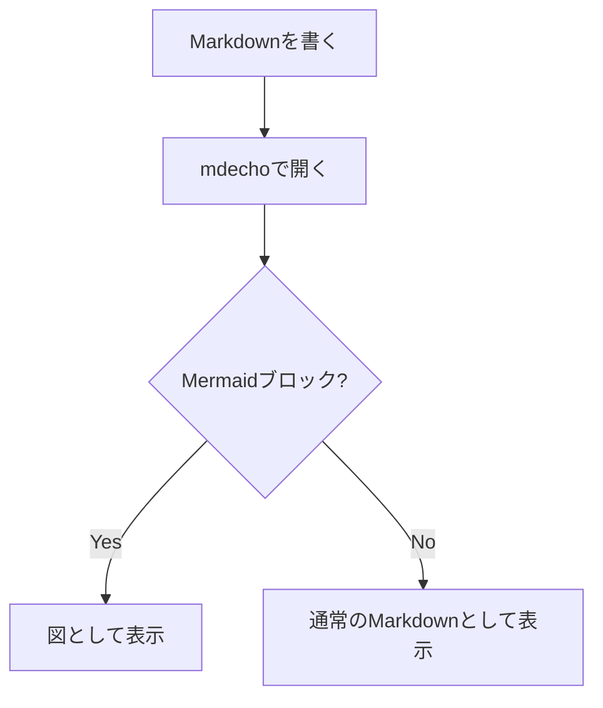

# 見出しレベル1

## 見出しレベル2

### 見出しレベル3

これは通常の段落です。**太字**や*斜体*、`インラインコード`、[リンク](https://example.com)を含みます。

## リスト

順序なしリスト(loose、間に空行あり):

- りんご

- みかん
  - 温州みかん
  - デコポン

- ぶどう

順序ありリスト(tight、間に空行なし):

1. 準備する
2. 実行する
3. 確認する

## テーブル

| 項目 | 左揃え | 中央揃え | 右揃え |
| :--- | :--- | :---: | ---: |
| 見出し | left | center | right |
| データ | abc | def | 123 |

## 引用

> これは引用です。
>
> > ネストした引用です。

## コードブロック

Mermaid:



言語指定あり(TypeScript):

```ts
function greet(name: string): string {
  return `Hello, ${name}!`;
}
```

言語指定あり(Bash):

```bash
echo "Hello, World!"
```

言語指定なし:

```
plain text block
no syntax highlighting
```

meta文字列付き:

```ts title="example.ts"
const x: number = 1;
```

## 改行

remark-breaksの導入により、通常の改行(Enterキー1回)がそのまま`<br>`になります。

1行目です。
2行目です(1回のEnterで改行されます)。

空行を挟むと、これまで通り別の段落になります。

新しい段落です。

行末に半角スペース2個を置く従来のhard break方式も引き続き動作します(下の行の行末に半角スペース2個あり)。  
次の行です。
