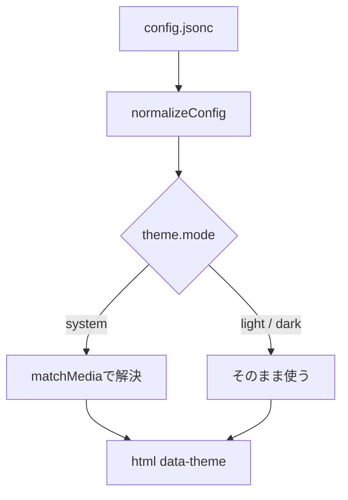
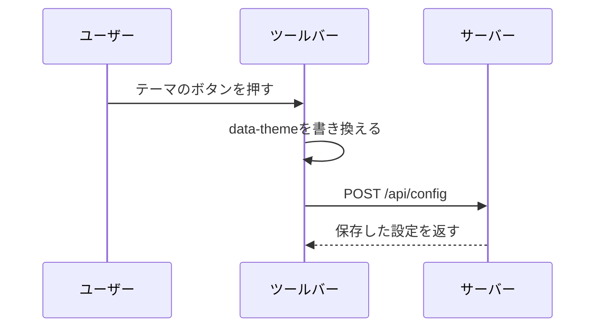
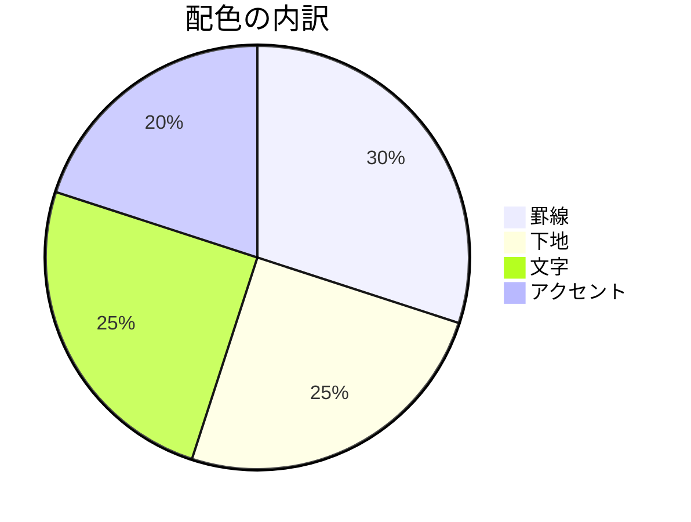

# 配色のサンプル

色が付く要素をひととおり並べたサンプルです。ツールバーのテーマ切り替えでライト/ダーク/システム追従を行き来しながら、罫線・下地・文字色のコントラストが保たれているかを眺めてください。

ライトモードでは、この変更の前と後で見た目が変わらないことが確認できればOKです。ダークモードでは、本文・コードブロック・図・表・コメント欄がそろって切り替わり、どれも読めることが確認したいところです。

## 文字と罫線

上の`h1`と、この`h2`の下に引かれた罫線の濃さを見てください。
背景に対して薄すぎると見出しの切れ目が消え、濃すぎると本文より罫線が目立ってしまいます。

### 見出しレベル3

#### 見出しレベル4

##### 見出しレベル5

###### 見出しレベル6

段落の中には**太字**や*斜体*、~~打ち消し~~、`インラインコード`、[リンク](https://example.com)が混ざります。
リンクの色は、地の文から浮きつつ読みづらくならない濃さが要ります。

`--mdecho-content-width` のようなハイフン混じりのトークン名や、`rgba(9, 105, 218, 0.08)` のような値もインラインコードで書かれます。
チップの下地が濃すぎると文字が沈み、薄すぎるとチップに見えません。

---

区切り線(`hr`)の上下です。罫線1本だけなので、背景に溶けていないかを確かめてください。

## 引用

> 引用の中の文字は、地の文より少し落とした色にしています。落としすぎると読めず、落とさないと引用だと分かりません。
>
> > ネストした引用です。左の罫線が2本並んだときの間隔と濃さを見てください。

> 引用の中に`インラインコード`と[リンク](https://example.com)、それに **太字** を混ぜた場合です。
> 文字色を落とした地の文の上で、それぞれが区別できるかを確かめます。

## リストとガイド線

ネストしたリストの左に引いたガイド線は、罫線よりさらに一段薄い色です。背景との差が小さいので、ダークモードで消えていないかがいちばん怪しいところです。

- 第1階層の項目です。折り返すくらいの長さにしておくと、ガイド線がどこまで伸びているのかが見えます。
  - 第2階層の項目です。
    - 第3階層の項目です。ここまで来るとガイド線が3本並びます。
  - 第2階層に戻ります。
- 第1階層の別の項目です。

1. 順序ありリストの1番です。
   1. ネストした順序ありリストです。
   2. 数字の色は本文と同じです。
2. 順序ありリストの2番です。

- [ ] 未チェックのチェックボックスです。
- [x] チェック済みのチェックボックスです。

## 表

ヘッダーの下地・ゼブラ縞・セルの罫線という3段階の色が並びます。ヘッダーが縞より濃く、縞が背景よりわずかに濃い、という順序が保たれているかを見てください。

| 設定キー | 既定値 | 範囲 | 説明 |
| --- | --- | --- | --- |
| `theme.mode` | `system` | `system` / `light` / `dark` | 配色をOSに合わせるか、固定するかを決めます。 |
| `theme.light` | `{}` | daisyUIの色トークン | ライトモードの色を上書きします。 |
| `theme.dark` | `{}` | daisyUIの色トークン | ダークモードの色を上書きします。 |
| `layout.contentWidth` | `1024` | 480〜2400 | 本文の最大幅(px)です。 |
| `layout.fontSize` | `16` | 12〜32 | 本文の文字サイズ(px)です。 |
| `layout.lineHeight` | `1.75` | 1.2〜2.4 | 本文の行の高さの倍率です。 |
| `font.body` | `[]` | フォント名の配列 | 本文のフォントを前から順に試します。 |
| `font.code` | `[]` | フォント名の配列 | コードブロックのフォントを前から順に試します。 |

偶数行の`インラインコード`は、ゼブラ縞と同じ色の下地だと背景に溶けて消えてしまいます。
下の表で、縞の行に乗ったチップがちゃんとチップとして見えているかを確かめてください。

| 行 | インラインコードを含むセル |
| --- | --- |
| 1行目(白) | `--color-base-100` の上のチップです |
| 2行目(縞) | `--color-base-200` の上のチップです |
| 3行目(白) | `--color-base-300` の上のチップです |
| 4行目(縞) | `color-mix()` で導出したチップです |

### 横に長い表

右上の「拡大」ボタンでモーダルを開くと、sticky headerの下を縞の行が流れていきます。ヘッダーの罫線は`box-shadow`で描き直しているので、そこが背景と同じ色になっていないかを見てください。

| トークン | ライト | ダーク | 用途 | 備考 |
| --- | --- | --- | --- | --- |
| `base-100` | `#ffffff` | `#0d1117` | ページとツールバーの背景 | いちばん下の地の色です。 |
| `base-200` | `#f6f8fa` | `#161b22` | ゼブラ縞、コメント欄の下地 | 地の色よりわずかに濃くします。 |
| `base-300` | `#d1d9e0` | `#30363d` | 罫線、表ヘッダーの下地の元 | 罫線として見える濃さが要ります。 |
| `base-content` | `#1f2328` | `#e6edf3` | 本文の文字色 | 引用の文字色もここから導出します。 |
| `primary` | `#0969da` | `#4493f8` | リンク、カーソル行 | 下地はこの色を薄めて作ります。 |
| `warning` | `#9a6700` | `#d29922` | コメントの帯 | 行番号のマークと吹き出しの左帯です。 |
| `error` | `#cf222e` | `#f85149` | エラー文字 | mermaidの失敗表示にも使います。 |

## コードブロック

言語ごとにハイライトの色数が違うので、いくつか並べます。背景は指定せずページの地の色を透かしているため、罫線1本でブロックの範囲が分かるかどうかが見どころです。

TypeScript:

```ts
import { type ThemeMode, resolveThemeMode } from "./theme-css.ts";

/** OSの設定に合わせるモードなら、いま暗いかどうかで解決する。 */
export function pickTheme(mode: ThemeMode, prefersDark: boolean): "light" | "dark" {
  const resolved = resolveThemeMode(mode, prefersDark);
  console.log(`[mdecho] theme=${mode} resolved=${resolved}`);
  return resolved;
}
```

JSONC(設定ファイル):

```jsonc
{
  "theme": {
    // "system" | "light" | "dark"
    "mode": "system",
    "dark": {
      "base-100": "#000000",
      "base-content": "#f0f6fc",
    },
  },
}
```

CSS:

```css
[data-theme="dark"] .shiki,
[data-theme="dark"] .shiki span {
  color: var(--shiki-dark);
}
```

Bash:

```bash
# テーマを固定して起動する
mdecho -f examples/theme.md --no-split-sentences
grep -rn "base-300" frontend/styles.css | head -5
```

Diff:

```diff
-  border-bottom: 1px solid #d1d9e0;
+  border-bottom: 1px solid var(--color-base-300);
```

言語指定なし:

```
色の指定が無いプレーンなブロックです。
ハイライトが効かないので、地の文字色がそのまま出ます。
```

横に長い行(横スクロールします):

```ts
const veryLongDeclaration = { baseHundred: "#ffffff", baseTwoHundred: "#f6f8fa", baseThreeHundred: "#d1d9e0", baseContent: "#1f2328", primary: "#0969da" };
```

## Mermaid

図の中の色はmermaid側のテーマが持っています。図の下地はページの地の色なので、mermaidのテーマとページの配色が喧嘩していないかを見てください。

フローチャート:



シーケンス図:



円グラフ(塗りの色数が多い図):



## コメント

行番号の左に出る吹き出しアイコンからコメントを書くと、吹き出しの左に帯が付きます。帯の色と、行番号側のマークの色が同じ系統に見えるかを確かめてください。

コメント欄の中もMarkdownとしてレンダリングされるので、コメントに次のような内容を貼って確かめられます。

```text
`インラインコード` と [リンク](https://example.com) と引用:

> 引用の中の文字色

| 表 | ヘッダー |
| --- | --- |
| 1行目 | セル |
```

カーソル行(`j` / `k` で移動)の下地と左のバーも、この段落で確かめられます。
複数行を選ぶには吹き出しアイコンを上下にドラッグしてください。選択中だけ濃い下地になります。
